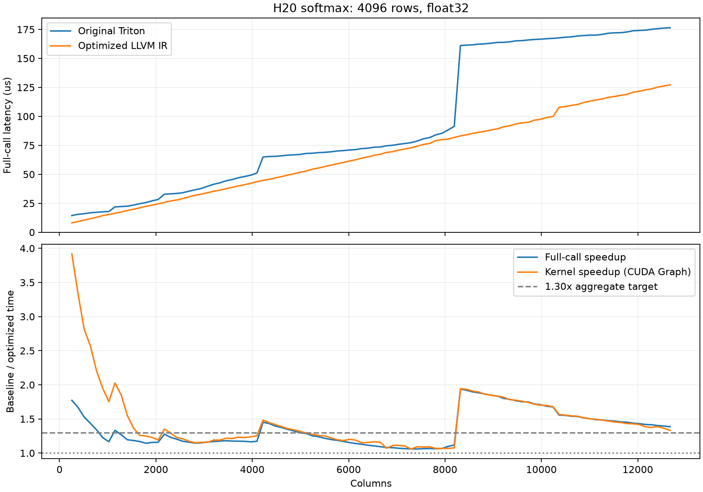

# Softmax LLVM IR 优化记录

## 任务与验收约定

- 原始基线：未经修改的 `triton_softmax.py`，4096 行、256–12672 列（步长 128），共 98 个 float32 shape。
- 完整公开调用的逐 shape 加速比等权几何平均 ≥ 1.30，各 shape 不得有显著退化。
- 完整调用计时包括分配、启动，排除首次编译；另测纯 kernel。
- 允许 shape 特化及启动参数、metadata、分派代码调整。
- 保留连续二维 CUDA float32、1–16384 列接口；正确性以 torch.softmax 为参照，rtol=1e-5、atol=1e-6。
- 使用 `/data/wangzhen/miniconda3/envs/ir-ops/bin/python`，GPU 1（H20 / SM90）。
- 仅导出未经修改的 Triton 基线 IR。所有计算优化直接在 LLVM IR 层实现，不修改 Triton 计算代码来生成优化 IR。

## 初步调查

原加载器每次调用读取 89 KiB IR 文本，并始终使用 block=16384 的版本。
大 block 原始 IR 使用 196640 字节共享内存，以 cp.async 做多级流水线；该资源占用限制驻留 CTA 数。
现有 benchmark 仅覆盖 (4096,8320)，需要扩展为完整 98 shape 并保留逐轮数据。

## 实验记录

### 1. 基线导出与已有实现验证

`export_softmax_ir.py` 对所有 98 个 shape 调用原始 kernel 的 warmup，保存其 `asm['llir']`，未修改任何 Triton 计算代码。
实际得到 7 个不同的编译结果，按 SHA256 去重保存在 `ir_baseline/`，`manifest.json` 提供每个 shape 到文件、寄存器数、共享内存用量的映射。
原有 4 个 unittest 全部通过。

### 2. 寄存器驻留、二次幂分档（第一版）

直接重写 LLVM IR：128 线程/CTA，列宽 ≤1024 时每个 warp 负责一行，否则每 CTA 一行。
使用谓词保护的 16 字节向量加载、寄存器内 max/sum、warp shuffle、仅 16 字节跨 warp 共享归约、近似 exp2 和倒数、向量存储。
保持减去行最大值的数值稳定性。取消 cp.async 多级流水线和持久化行循环。
加载器按 GPU 和列宽缓存编译结果，避免每次打开 IR 文件。

第一版 98 shape、3 轮探索结果（`perf_llir_explore/`）：

- 完整调用几何平均加速比 **1.2393**，最低 **1.0653**，未达到 1.30。
- kernel 几何平均加速比 **1.2878**，最低 **0.9657**；该最低值的测量区间跨过 1，无显著退化。
- 所有 shape 正确性通过；内存检查 0 errors。

测量修正：最初 8 shape smoke 的 kernel 捕获错误地复用了默认 stream，产生空 CUDA Graph，其 kernel 数据全部作废。
改为在每次 launch 时查询当前 stream，再重新测量。上述探索数据及最终验收均来自修复后的测量。

### 3. 非二次幂展开与线程数比较（第二版）

在另一张空闲 H20（GPU 2）进行独立候选筛选，避免干扰 GPU 1 上的基线探索。
比较 128/256/512 线程、warp-per-row 与 CTA-per-row、二次幂与实际列宽取整的展开范围。
候选结果保存在 `perf_llir_tuning/results.json`；这些单次候选测量仅用于选型，不作为正式验收。

| 列数 | 第一版 kernel / µs | 缩减展开后 / µs | 改动 |
|---:|---:|---:|---|
| 5504 | 60.12 | 52.61 | 128 线程，展开 8192 → 5632 |
| 8320 | 106.99 | 79.07 | 128 线程，展开 16384 → 8704 |
| 12672 | 128.38 | 123.05 | 128 线程，展开 16384 → 12800 |

增加线程数并非稳定更快，最终保留 128 线程。小列宽按 128 列取整（最小 256），大列宽按 512 列取整，保存 37 份独立 `.llir`，覆盖原接口全部 1–16384 列。
这减少了尾部无效计算与寄存器压力。加载时只执行 LLVM IR → PTX → cubin 后端步骤。
`edit_softmax_ir.py` 是直接写入 LLVM SSA 指令文本的机械展开工具，不使用 Triton frontend；运行时以 `ir_optimized/*.llir` 文件为源。

### 4. 正式验收（通过）

GPU 1，98 shape，每组 5 轮，基线与优化版交替顺序；每轮完整调用预热 30ms、采样 150ms。
每轮另用预分配输出和 CUDA Graph 采样 kernel（rep=20ms，Triton 内部进行 10 次 replay 计时）。
两类结果的缓存/调用条件不同，因此仅在各自测量模式内比较两种实现。
每个 shape 取逐轮中位数的中位数，再计算等权几何平均加速比。
使用配对轮次的 log 加速比 bootstrap 95% 区间判断显著退化（区间上界 <1）；小样本区间仅反映本次运行波动。
所有公开与独立 kernel 路径在计时前对照 torch.softmax 检查精度。
保存逐轮耗时、各 shape 误差、寄存器/共享内存/grid、环境与源码 SHA256。

## 最终结果

**验收通过。** 全部 98 shape、每组 5 轮测量结果如下：

| 指标 | 完整公开调用 | 纯 kernel（CUDA Graph） |
|---|---:|---:|
| 等权几何平均加速比 | **1.337705×** | **1.428181×** |
| 最低逐 shape 加速比 | 1.059888× | 1.059593× |
| 显著退化 shape 数 | 0 | 0 |

完整调用整体加速 **33.77%**（等价几何平均耗时减少 25.25%），超过约定的 30% 加速目标。每个 shape 的中位数均快于基线。
所有正确性检查通过；98 组随机输入的最大绝对误差为 **2.98023224e-08**。

| 列数 | 基线完整调用 / µs | 优化完整调用 / µs | 加速比 |
|---:|---:|---:|---:|
| 256 | 14.464 | 8.160 | 1.773× |
| 1024 | 17.920 | 15.360 | 1.167× |
| 4096 | 51.136 | 43.648 | 1.172× |
| 7424 | 78.720 | 74.272 | 1.060× |
| 8320 | 161.120 | 83.104 | 1.939× |
| 12672 | 176.416 | 127.232 | 1.387× |

完整数据：[汇总](perf_llir/summary.json)、[逐 shape CSV](perf_llir/results.csv)、[逐轮原始数据及环境/源码哈希](perf_llir/results.json)。
已核对基线 `triton_softmax.py` 与 Git 原版本字节一致，98 shape 导出的 IR 哈希正确，测量开始记录的全部源码哈希与最终交付文件一致。



## 正确性与内存验证

最终 unittest 共 8 项，通过检查包括：原有形状与未对齐 storage offset、空行、全部 37 个分档的相邻列宽、极端有限值/NaN/Inf、非默认 stream、非当前 GPU 输入及当前设备恢复。
在 GPU 2、3 上运行 Compute Sanitizer memcheck：8 项全部通过，**0 errors**。
在 GPU 2 上运行 racecheck：7 项通过、跨 GPU 项因只暴露一张卡跳过，**0 hazards / 0 errors / 0 warnings**。
完整日志位于 `perf_llir_tuning/memcheck_final.log` 与 `racecheck_final.log`。

## 使用与复现

```python
from softmax_llir import softmax_from_llir
y = softmax_from_llir(x)
```

默认按输入列数分派，首次调用编译相应 `.llir`；编辑 IR 后重启 Python 进程以刷新缓存。
生产调用不会运行 `export_softmax_ir.py` 或 `edit_softmax_ir.py`。

```bash
# 在项目目录内执行；正式性能验收
CUDA_VISIBLE_DEVICES=1 /data/wangzhen/miniconda3/envs/ir-ops/bin/python benchmark_softmax_llir.py --rounds 5 --warmup-ms 30 --rep-ms 150 --kernel-rep-ms 20 --output perf_llir

# 数值、边界、stream 与跨 GPU 测试
CUDA_VISIBLE_DEVICES=2,3 /data/wangzhen/miniconda3/envs/ir-ops/bin/python -m unittest -v test_softmax_llir

# 根据已有结果生成图，不重跑性能测试
/data/wangzhen/miniconda3/envs/ir-ops/bin/python plot_softmax_results.py perf_llir
```

目标环境为本机 NVIDIA H20 / SM90、PyTorch 2.12.0+cu130、Triton 3.7.0。
结果仅代表该环境及约定的 98 组输入；兼容接口的其他尺寸验证正确性，不纳入本次性能验收。
