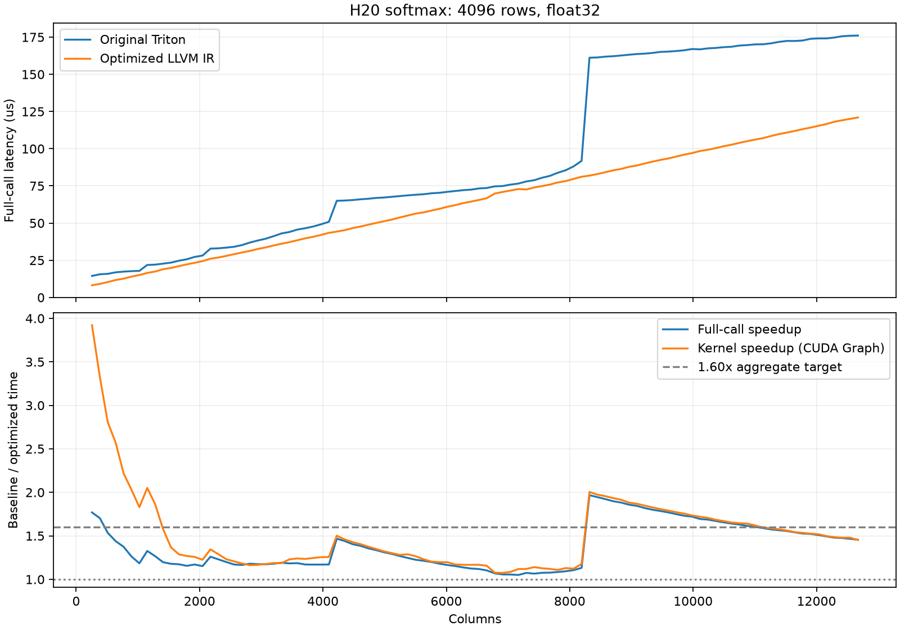

# Softmax LLVM IR 第二轮优化：目标 >1.6×

## 验收要求

- 保持原始 `triton_softmax.py` 基线、98 个 shape（4096 行，256–12672 列，步长128）。
- 完整调用的等权几何平均加速比 **>1.6**，每个 shape 无显著退化。
- 每个 shape 5 轮交替顺序测量，保留独立 kernel 数据；rtol=1e-5、atol=1e-6。
- 直接修改 LLVM IR，不通过修改 Triton 计算代码生成优化 IR。
- 使用 ir-ops Python 环境，保留 1–16384 列接口及数值、边界、stream、跨 GPU 正确性。

## 起点

上一轮正式结果位于 `perf_llir/`：完整调用几何平均 1.337705×，kernel 1.428181×，最低逐 shape 完整调用加速比1.059888×。
当前 IR 每 CTA 处理一行（小列宽每 warp 一行），直接寄存器加载/归约，共享内存0或16字节。
本轮先验证持久化 CTA 行循环是否能降低大量短 CTA 的调度开销，再根据实测选择后续方向。

## 实验记录

本轮实验及测量已记录；>1.6× 的整体目标尚未达成。

### 已完成的诊断与候选筛查

- 持久化行循环：7 个代表尺寸、128/256线程、1/2/4/8/16 CTA/SM，没有优于原版本。
- 缓存提示、每 CTA 多行、访问组轮转、整数 redux max：没有足够收益，结果分别保存在 `perf_cache_tuning/`、`perf_rows_tuning/`、`perf_rotate_tuning/`。
- 非尾部取消 mask：12672 列由约126.9µs降至121.3µs，但中等列宽基本不变。
- 带稳定回退的无平移 exp 快路径：通过所测精度检查，但显著变慢，不采用。
- Nsight Compute（6144列）：DRAM约81.46%、L2约80.22%，无寄存器溢出，表明主要受内存吞吐限制。
- 纯拷贝诊断：相同布局8192列约80.8µs、12672列约120.4µs，已接近 Softmax 耗时。另测 Torch copy 与 CUDA copy engine，未找到更高的传输速度。该实验仅用于诊断，绝不作为 Softmax 成绩。
- TMA批量写回与TMA整行加载：所测尺寸没有明显改善，不采用。
- L1/shared carveout比较：prefer-shared 反而减速，保留默认策略。

目标仍未达成。当时正式路径仍为上一轮版本；随后仅合入了下述边界判断优化，其他实验保持独立。

### 后续排查

- 设备查询确认支持 CUDA generic compression，但原始 FP32 结果采用无损压缩分配没有明显收益。
- 有界舍入 + 压缩的独立实验：细粒度舍入无收益；接近既定绝对误差上限的舍入在部分大尺寸可加速，但概率和误差升至约1e-4量级，且仍不足以保证目标。未接入正式实现；没有引入额外舍入或定制压缩分配。
- 64–1024线程、含3/6/10/12等非二次幂warp数量的筛查，未找到显著超越128线程的配置。
- 持久化行循环 + 下一行 L2 预取，未找到稳定改善。

### 本轮保留的改动

对分档内保证有效的完整向量组直接执行 load/store，仅尾部保留边界判断；最小256列分档仍全量保留 mask，以兼容1–256列输入。
保持减行最大值、FP32归约、原有exp/倒数算法；不使用实验性的舍入、复制内核、TMA、压缩内存或无平移exp。
12800列展开版本的寄存器数由147降至124。
本轮运行时源为 `ir_optimized/*.llir`，上一轮源保存在 `ir_checkpoint_1_338/`。

### 正式测量

命令（与上一轮相同采样口径，新目标使用独立的显式门槛）：

```bash
CUDA_VISIBLE_DEVICES=1 /data/wangzhen/miniconda3/envs/ir-ops/bin/python benchmark_softmax_llir.py --rounds 5 --warmup-ms 30 --rep-ms 150 --kernel-rep-ms 20 --target-speedup 1.6 --output perf_llir_round2
```

结果写入 `perf_llir_round2/`，包含每轮数据和当前运行时源码哈希。
8项数值/接口测试在双GPU memcheck下全部通过，0 errors，日志位于 `perf_round2_validation/memcheck.log`。

### 本轮测量结果（未达目标）

- 完整调用几何平均加速比：**1.359663×**（上一轮1.337705×）。
- 纯 kernel 几何平均加速比：**1.464707×**。
- 最低逐 shape 完整调用加速比：**1.050483×**，列数7168；98组均快于原始基线，无显著退化。
- 最大绝对误差：**2.98023224e-08**；8项测试及memcheck通过。
- `accepted=false`：本轮明确使用>1.6门槛，不沿用上一轮1.3门槛冒充达标。
- 最后补测max/sum分离共享内存、将4次barrier减至2次，未发现稳定收益，未合入。

[完整结果](perf_llir_round2/results.json) · [汇总](perf_llir_round2/summary.json) · [逐shape CSV](perf_llir_round2/results.csv)



已核对所有98组、每组5轮、当前运行时源码SHA256及未经修改的基线。当前证据支持1.359663×，不支持宣称达到1.6×；整体目标保持未完成。后续需要超出已排查的寄存器/线程块/缓存提示/TMA局部调参，寻找新的内存传输或调度改善，并沿用同一验收口径。
